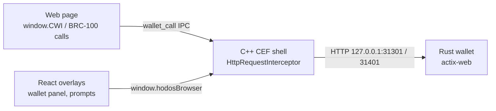
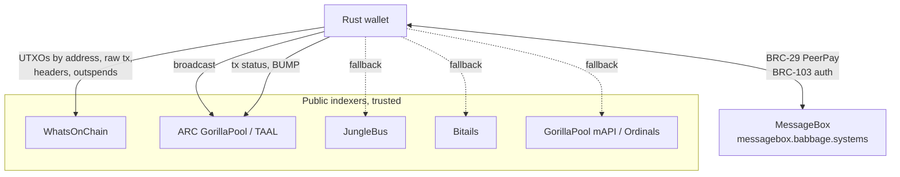
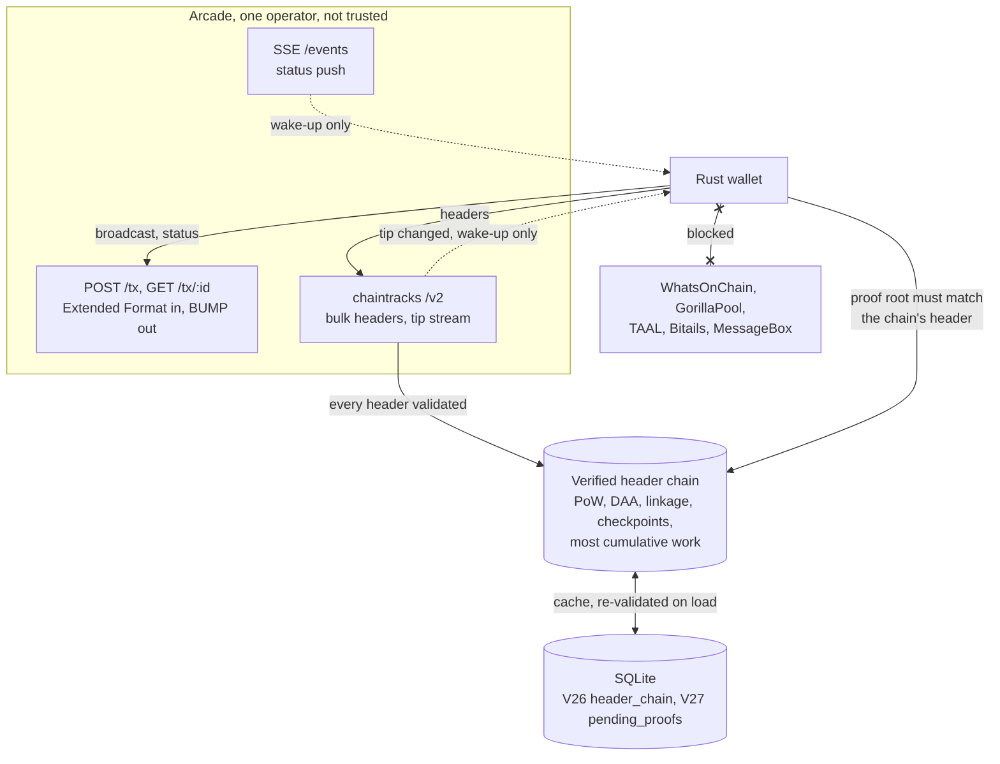
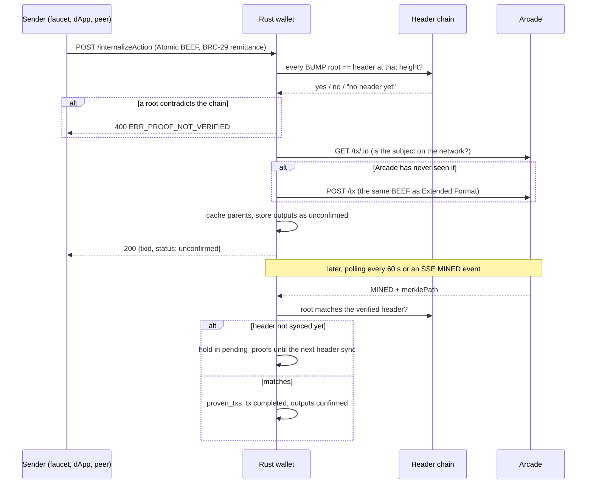

# Architecture diff: public-indexer wallet → spv wallet

> **Written 2026-10-14** for the `spv-testnet` branch (PR #3). Describes how the browser and
> wallet got their chain data before this work (**public mode**, still the default) and how they
> get it with `HODOS_CHAIN_MODE=spv` (**spv mode**). Both modes ship in one binary; the switch is
> an environment variable read at startup. Layer inventory stays in the per-directory `CLAUDE.md`
> files; this doc carries only the cross-layer flow and what moved.

## 1. What did not change

The browser. Every layer above the wallet's HTTP API is the same code on both modes:

Permission gates, prompts, the IPC bridge, the BRC-100 endpoint surface, key handling and
signing are untouched; nothing under `cef-native/` or `frontend/` changed on this branch. What
changed is **where the wallet looks when it needs to know something about the chain**, and
therefore which features can work without a public indexer.

## 2. Before: public mode (`HODOS_CHAIN_MODE` unset)

The wallet trusts a set of public indexers. Each question has a fallback chain of providers
(`services/mod.rs :: WalletServices`), and the answer of whichever provider replies first is
taken as fact.

How money arrives and is proven:

| Concern | Public mode |
|---|---|
| Discover a received output | `TaskSyncPending` polls **addresses** on WhatsOnChain (30 s / 3 min / 5 min tiers); `/wallet/sync` on demand |
| Learn a parent transaction | Fetch raw tx from ARC → WoC → JungleBus |
| Block headers | Fetched per height from WoC / JungleBus and **cached as given** (`block_headers`); the server's say-so |
| Merkle proof | ARC BUMP or WoC TSC proof, checked against that cached header |
| Is a tx on the network? | Three-oracle txid quorum (WoC, JungleBus, Bitails) |
| Double-spend suspicion | Adjudicated by WoC `/spent` lookups, auto-escalated after 6 h |
| Receive a payment from a peer | MessageBox polling (`TaskCheckPeerPay`), BRC-2 encrypted, BRC-103 authenticated |
| `/getNetwork` | `mainnet` |

The trust model: a header is true because a server returned it; a proof is true because it
matches that header. Anyone who controls the answers of WoC/JungleBus controls what the wallet
believes is confirmed.

## 3. After: spv mode (`HODOS_CHAIN_MODE=spv`)

The wallet talks to **one** service, Arcade, and verifies everything it is told against a header
chain it builds and checks itself. Public indexer hosts are blocked at the transport layer
(`chain_mode::get/post` send them to a `.invalid` sink), so a forgotten call site fails like a
network error and can never become a verdict.

### 3.1 Headers are verified, not cached

`header_chain.rs` is pure logic: every header must have the right length, valid proof-of-work,
the exact `bits` the network's difficulty rule requires for its position, a known parent, a
plausible timestamp, and the pinned hash at every checkpoint height. The active chain is the
one with the most cumulative work, never the one a server calls its tip. Storage (`header_chain`
table) is a cache: every stored header is re-validated on load, and garbage is dropped and
counted.

Two networks are supported, selected by `HODOS_CHAIN_NETWORK`:

| | `regtest` (local stack) | `teratestnet` (public Teranode testnet, **default**) |
|---|---|---|
| Difficulty | fixed `0x207fffff` | cw-144 DAA + 20-minute minimum-difficulty rule, ported from Teranode `Difficulty.go` |
| Genesis | pinned | pinned (`go-chaincfg` `TeraTestNetParams`) |
| Checkpoints | none | 5000 / 9500 / 18000 |
| Sync | per height | bulk `/headers?height=&count=`, 2000 per request; ~36k headers in about a minute |

### 3.2 Money arrives inside BEEFs, not by address

There is no address lookup in spv mode (`fetch_utxos`, `get_raw_tx`, `outspend` hold only
`SpvNoIndexerProvider`, which always errors). A payment reaches the wallet as **Atomic BEEF**
through `POST /internalizeAction`: the transaction, its parents, and the merkle paths of every
mined ancestor. The wallet checks each BUMP against its own header chain before storing anything.

What this changes, concern by concern:

| Concern | Public mode | spv mode |
|---|---|---|
| Discover a received output | address polling on WoC | only inside a BEEF via `internalizeAction` |
| Parent transactions | fetched from an indexer when needed | taken from the BEEF and cached (`parent_transactions`), because there is nowhere to fetch them later |
| Headers | cached as served | verified chain, bulk-synced, most-work selection, reorgs detected and reported |
| Merkle proof | checked against a cached header | checked against the verified chain; a proof the chain cannot judge yet is **held** (`pending_proofs`), never stored as proven |
| After a reorg | nothing | `TaskRecheckProofs` re-verifies every stored proof above the fork and swaps in the re-mined one |
| Is a tx on the network? | three public oracles | Arcade only; its errors are "inconclusive", never "gone", so a mined tx is never failed during an outage |
| Spend a received, unmined output | after confirmation | zero-conf: spendable once Arcade reports it `SEEN_ON_NETWORK` with no conflict (`HODOS_ZERO_CONF=off` to disable) |
| Proof latency | 60 s polling | SSE push wakes the proof check within seconds; polling stays as the safety net |
| MessageBox / PeerPay | on | off: polling is a no-op, `/wallet/peerpay/send` refused with 503 before anything is broadcast |
| `/getNetwork` | `mainnet` | `testnet` |
| Re-broadcast of a tx Arcade has not seen | bare raw tx | the Atomic BEEF (Arcade needs the parents for Extended Format); this fix applies to public mode too |

### 3.3 The trust model, stated plainly

Arcade can **withhold** (an outage looks like "unknown", and the wallet waits) and it can
**delay**, but it cannot make the wallet believe a transaction is confirmed: that needs a merkle
path whose root is in a header that carries valid proof-of-work at the difficulty the chain's
own history demands, on the branch with the most work. A fake branch on the testnet would need
more work than the real one. The minimum-difficulty rule helps an attacker less than it looks:
a 20-minute block carries 2^32 work, a real block at the time of writing (`bits 0x1c5c0168`)
about 2^33.5, so cheap blocks earn roughly a third of the work per block and may only come
every 20 minutes, against the honest chain's ~10. The margin is real but not large; it is why
the checkpoints exist and why a recent one is worth adding.

What the model does **not** cover yet: median-time-past is not enforced (timestamps can be
backdated within a branch, which affects nothing while most-work wins), and a 51% attacker on a
test network is not a threat this wallet is meant to resist.

## 4. Operating it

| Variable | Meaning |
|---|---|
| `HODOS_CHAIN_MODE` | unset / `public` (default) or `spv` |
| `HODOS_CHAIN_NETWORK` | `teratestnet` (default) or `regtest`; unknown refuses startup |
| `HODOS_ARCADE_URL`, `HODOS_CHAINTRACKS_URL` | required in spv mode; refused if they point at a public indexer |
| `HODOS_ARCADE_SSE_URL`, `HODOS_ARCADE_PUSH=off` | push on/off (polling never off) |
| `HODOS_TIP_STREAM=off`, `HODOS_ZERO_CONF=off` | opt-outs |
| `HODOS_DEV=1` + `HODOS_DATA_DIR` | always, for a test wallet: the data dir ignores `APPDATA`, so an un-redirected run opens the real dev DB |

Harnesses: `rust-wallet/tests/spv-ttn/` (public testnet, faucet-funded; `connect.mjs`,
`fund.mjs`), and the local regtest stack (set `HODOS_CHAIN_NETWORK=regtest`).

## 5. Where this stops: mainnet

Mainnet spv is **not** a configuration change. The service side exists (checked live,
2026-10-14); the wallet side has two pieces of real work.

### 5.1 The public mainnet Arcade (exists; verified)

Four hosts, all Arcade **v0.16.0**, all serving `/chaintracks/v2`:

| Host | Observed |
|---|---|
| `arcade-v2-eu-1.bsvblockchain.tech` | healthy end to end during the probes; **use this one first** |
| `arcade-v2-us-1.bsvblockchain.tech` | named as the public mainnet instance in Arcade's issue tracker (bsv-blockchain/arcade #339) |
| `arcade-us-1.bsvblockchain.tech`, `arcade-us-1.bsvb.tech` | the BSVA pattern `arcade-${app_suffix}.bsvb.tech` (ts-stack `docs/infrastructure/index.md`); `.bsvb.tech` redirects to `.bsvblockchain.tech` |

What the wallet needs, as observed on the EU host:

| Need | Result |
|---|---|
| Genesis | header 0 hashes to `000000000019d6689c085ae165831e934ff763ae46a2a6c172b3f1b60a8ce26f` |
| Header integrity | hashes at 504031, 600000, 800000, 971000 equal WhatsOnChain's (independent source) |
| Bulk `/headers?height=&count=` | up to at least 71k headers per request; 2000-header batches ~1.5 s mid-chain (6.8 s at genesis, 3 s at the tip); a full 971k sync is 10-12 min at the wallet's batch size, under two at 50k per request |
| `/tip/stream` | present tip on connect, same frames as the testnet |
| SSE `/events?callbackToken=` | `200 text/event-stream`, `: keepalive` within ~15 s (a probe that gives up sooner sees nothing) |
| `/policy` | 1 sat/KB (below the wallet's 100 sat/KB sanity floor, so the 1000 sat/KB default applies, as on the testnet) |

Two caveats that shape the design:

- **A public chaintracks can reset under you.** During the probes the three US hosts went from
  serving 900000→tip to `height: 0` and headers 0-21987 only: their header store restarted and was
  re-bootstrapping from genesis, while `/health` kept reporting `blockHeight: 971087` (the datahub's
  height, not chaintracks'). The EU host was unaffected. The wallet's most-work rule already refuses
  to follow a tip that went backwards, but the sync will log errors until the server catches up:
  make the chaintracks URL a per-region setting and treat "server tip below ours" as *unavailable*,
  never as a reorg.
- **`GET /tx/:id` knows only transactions Arcade itself tracks.** Two random mined mainnet txs
  answered `404 transaction not found`, as on the testnet. The merkle-service
  (`merkle-service-us-1.bsvb.tech`) is **not** a proof lookup: its API is `POST /watch` (txid +
  callback URL) and `GET /api/lookup/{txid}`, and Arcade's README says the same. So the only proof
  source for a transaction without its own BUMP is Arcade after a (re-)submission, and that works:
  re-submitting an already-mined tx to the testnet Arcade answered `202 txStatus: MINED` with the
  merkle path at once. The `internalizeAction` re-broadcast (section 3.2) is exactly this path.

### 5.2 Still to build in the wallet

1. **Mainnet header rules.** `Params` deliberately has no mainnet constructor. Verifying from
   genesis means three difficulty regimes (2016-block retarget, the 2017 Emergency Difficulty
   Adjustment from 478558, then the DAA from 504031), or an **assume-valid checkpoint** near the
   tip with full rules only after it. The second is the normal wallet answer and the cheaper one;
   the chaintracks data supports either.
2. **Scale.** ~971k headers: the in-memory chain (`HashMap<String, Entry>` with hex strings) is
   a few MB for 36k and roughly 200 MB at mainnet size; the per-header ancestor walk for the DAA
   is fine, the `side_branch_has_root` scan over every entry is not. Both need a pass before a
   mainnet switch, not after.

Everything else in section 3 transfers as is.
